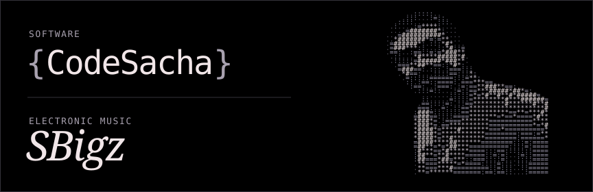

# Sacha Bigou

I’m a full-stack developer working across web, mobile, and automation. I build interfaces, connect APIs, and give AI agents access to the tools and data they need.

I release electronic music as **SBigz**.

## Selected work

### Synthwave ’2077

An open-source theme that brings a Cyberpunk-inspired palette to the tools I work in. I adapted it for Orca’s interface, editor, and terminal.

[VS Code repository](https://github.com/sachabigou/Synthwave-2077) · [Orca port](https://github.com/sachabigou/synthwave-2077-orca)

### SBigz

My electronic music project. It’s where I experiment with rhythm, texture, and sound outside the editor.

[SoundCloud](https://soundcloud.com/sbigz) · [Spotify](https://open.spotify.com/artist/0ggEZfElbLKckqn4O5vbcP)

## Stack

         

## Skills & how I work

### Technical skills

- **Web and mobile development.** I work with TypeScript, Next.js, and Vite on the web, and with Swift and React Native on mobile.
- **APIs and automation.** I connect apps to their data with Node.js, Payload CMS, and PostgreSQL. I use n8n for recurring work like collecting data and generating documents.
- **Developer tooling and visual design.** I ported Synthwave ’2077 to Orca and adapted the palette across its interface, editor, and terminal. [Synthwave ’2077 for Orca](https://github.com/sachabigou/synthwave-2077-orca)

### Soft skills

- **Clear communication.** I explain decisions, trade-offs, and next steps in terms the team can act on.
- **Ownership.** I carry work through implementation, verification, and handoff.
- **Creative problem-solving.** I make small prototypes to test ideas and get feedback early.

## Get in touch

Have a web product or an automation in mind? Tell me what you’re building.

[LinkedIn](https://www.linkedin.com/in/sacha-bigou) · [VERYDISCO](https://verydisco-agency.fr)
